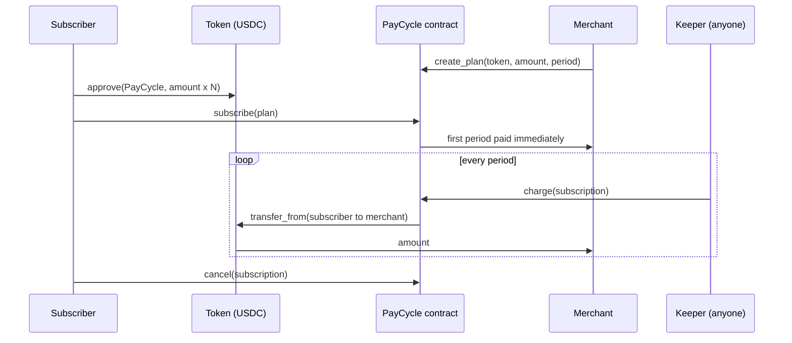

# Architecture

## Pieces
| Part | Responsibility |
|---|---|
| `contracts/` | Plans, subscriptions, due-date rules. Never custodies funds |
| `sdk/` | Typed client, in-memory mock, `runKeeperOnce` and a keeper CLI |
| `web/` | Merchant and subscriber UI. Works against the mock or a testnet contract |

## Rules (identical in contract and mock)
- Subscribing pays the first period at once. `next_charge = now + period`.
- `charge` succeeds only when `now >= next_charge` and both the subscription and the plan are active.
- After a charge, `next_charge += period`. If that is still in the past, it becomes `now + period`, so missed periods are skipped rather than billed retroactively.
- Cancelling or ending a plan stops all future charges. There are no refunds for the current period.
- Money amounts are `i128` base units (7 decimals for Stellar USDC).

## Why a keeper?
Soroban contracts cannot run on a timer. Because `charge` is permissionless, merchants, subscribers or third parties can run the keeper. Failing charges (for example, no allowance left) revert and change nothing.

## Known limits (see the issues list)
- Listing plans and subscriptions iterates ids. An event indexer would scale better.
- A failed charge has no grace period or retry state yet.
